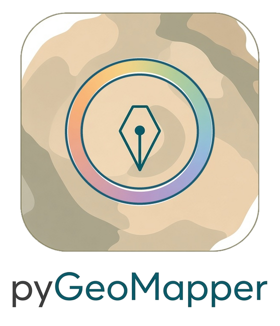
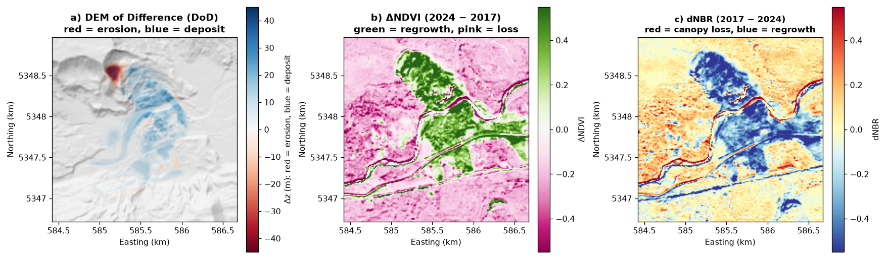
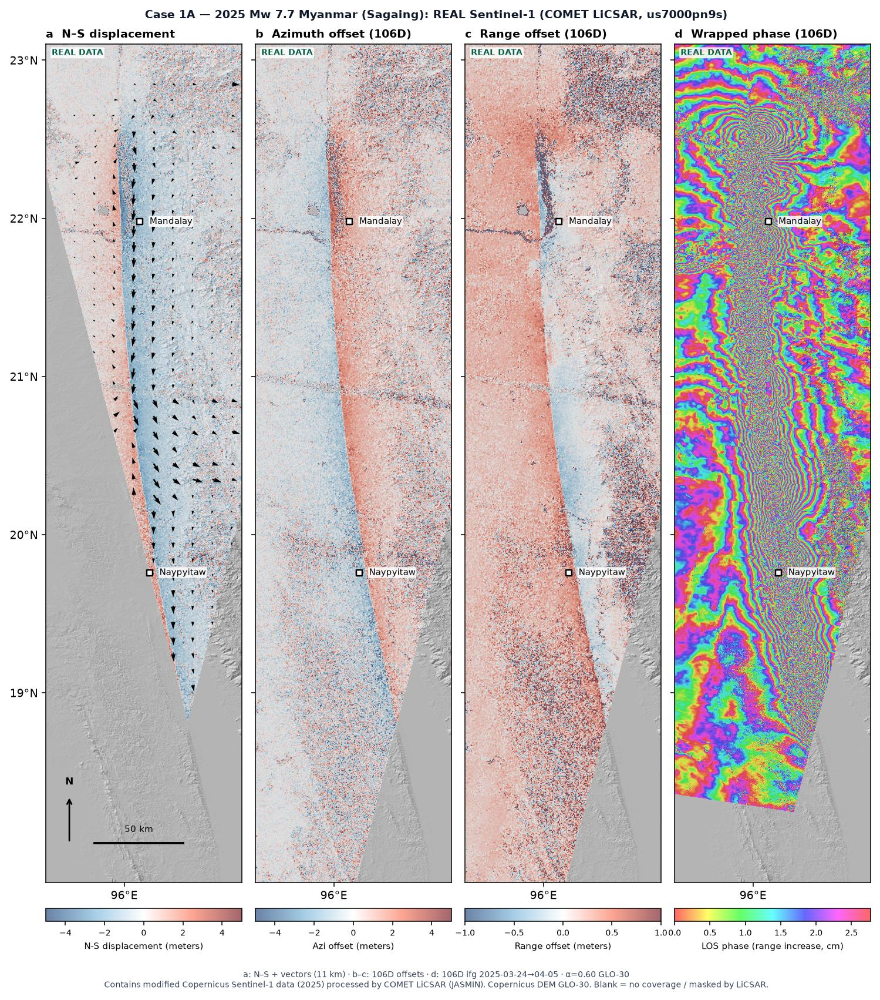
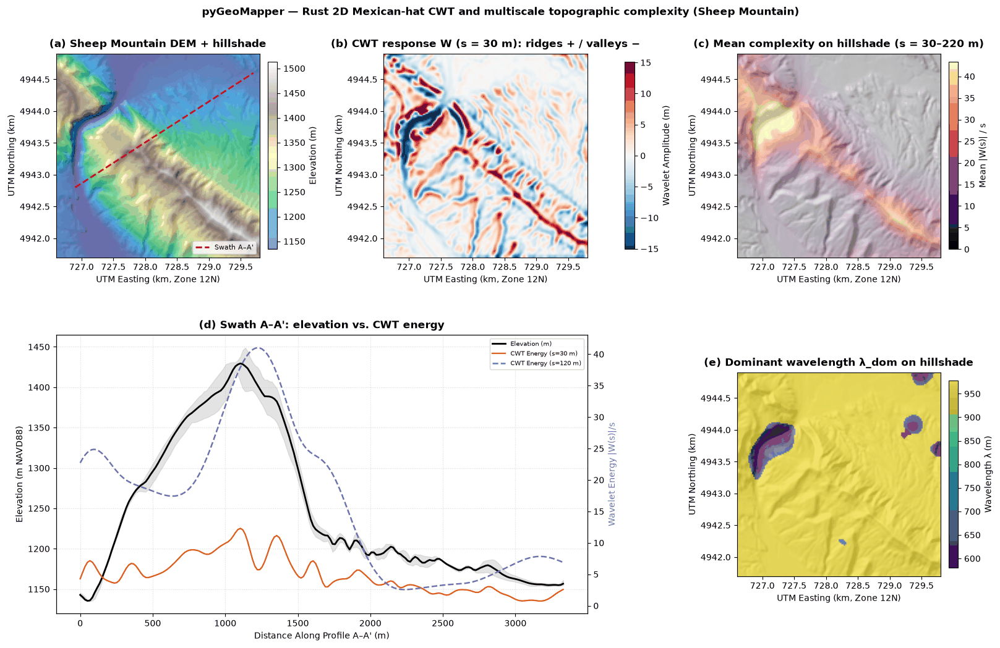
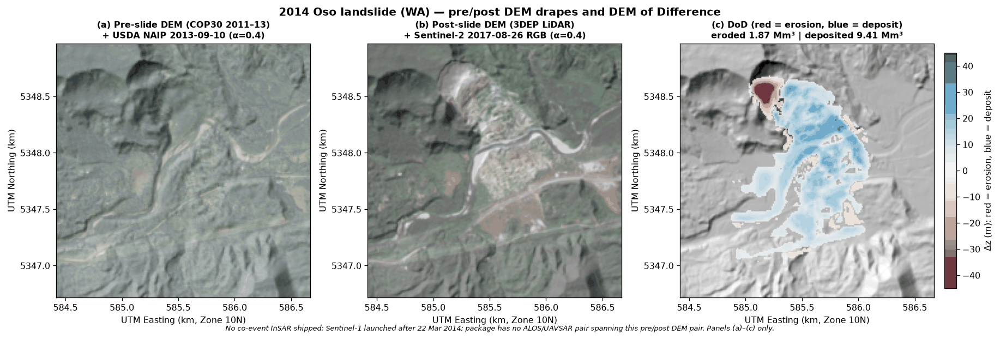
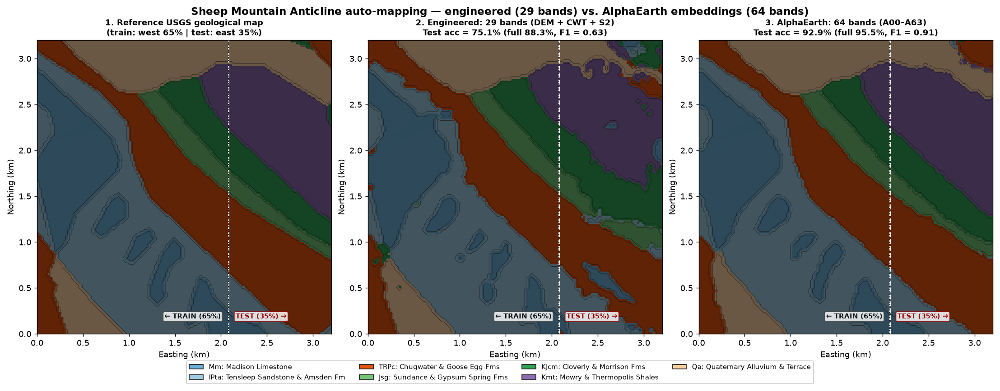
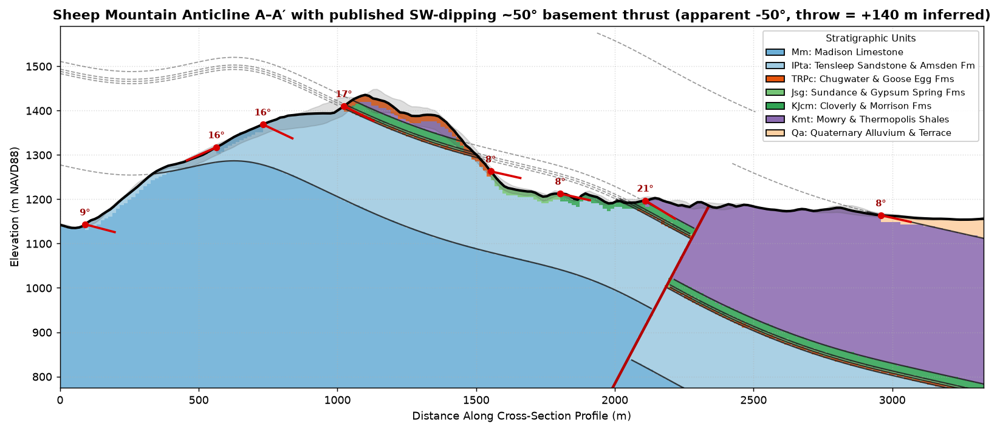
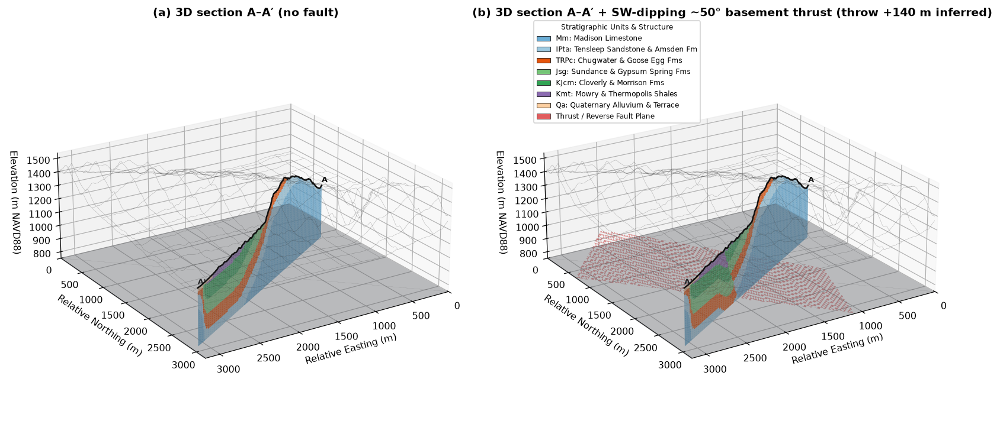

<p align="center"></p>

# pyGeoMapper

[](https://pypi.org/project/pygeomapper/) [](https://pepy.tech/project/pygeomapper) [](https://github.com/GeoLarryLai/pyGeoMapper/blob/main/LICENSE)


*DEM of Difference (red = erosion, blue = deposit) and spectral change after the 2014 Oso landslide, the two basic ways the package spots change on the ground.*

> [!WARNING]
> **pyGeoMapper** is under active development, and many functions are still experimental and not fully validated. Please use with caution.

**pyGeoMapper** maps what changed on the ground, and what it's made of, using satellite images and elevation models (DEMs). I wanted one place to go from raw rasters to something a geologist can actually read: change maps after a landslide, flood, wildfire, earthquake, volcano or glacier event, unit maps scored against a real geologic map, and cross-sections and 3D block diagrams you can open in a browser. It's Python with a Rust core. (Not related to `The-Magicians-Code/PyGeoMapper`.)

## How to cite

> Lai, L. S.-H. (2026). pyGeoMapper (version 0.2.0) [Computer software]. https://github.com/GeoLarryLai/pyGeoMapper

Full metadata is in `CITATION.cff` in the repository. Methods: [Horn (1981)](https://doi.org/10.1109/PROC.1981.11918),
[Zevenbergen & Thorne (1987)](https://doi.org/10.1002/esp.3290120107),
[Nuth & Kääb (2011)](https://doi.org/10.5194/tc-5-271-2011),
[Montero et al. (2023)](https://doi.org/10.1038/s41597-023-02096-0),
[Lai et al. (2025)](https://doi.org/10.5194/esurf-13-417-2025),
[Brown et al. (2025)](https://arxiv.org/abs/2507.22291),
[Okada (1985)](https://doi.org/10.1785/BSSA0750041135),
[Staley et al. (2017)](https://doi.org/10.1016/j.geomorph.2016.10.019),
[Horton et al. (2017)](https://doi.org/10.3133/ds1052). Data sources: `example_data/SOURCES.txt`, `NOTICE`.

## What it can do

- Measure surface change: DEM of Difference with co-registration, spectral change, and InSAR/GNSS 3D displacement (wrapped fringes on imagery, horizontal and vertical motion)
- Compute spectral indices (NDVI, NBR, NDWI, mineral ratios) and terrain metrics (slope, curvature, roughness, multiscale CWT complexity)
- Make unsupervised and supervised geologic unit maps, with spatial-block holdout accuracy
- Draw cross-sections and 3D block, cutaway and fence diagrams, and view them in an offline WebGL viewer
- Five executed notebooks walk through every module with public data

## Install

```bash
pip install pygeomapper
# from source (Python 3.10+, Rust 1.75+):
git clone https://github.com/GeoLarryLai/pyGeoMapper.git && cd pyGeoMapper
pip install maturin && maturin develop --release
```

`pip install pygeomapper` includes the `forge3d` 3D terrain renderer. If you installed from conda and the renderer is missing, run `pip install forge3d`; otherwise `viewer_3d` falls back to its built-in renderer automatically.

## Quick start

```python
from pygeomapper import raster_io, surface_change, terrain_analysis

dem1 = raster_io.load_geotiff("example_data/oso_dem_pre_cop30.tif")
dem2 = raster_io.load_geotiff("example_data/oso_dem_post_3dep.tif")
dod = surface_change.compute_dod(dem1, dem2)                        # elevation change between the two DEMs
cwt = terrain_analysis.compute_multiscale_complexity(dem2)          # terrain roughness at several scales
```

## Key features

- **Raster I/O (`raster_io`):** CRS-aware GeoTIFF/COG and multi-band stacks, STAC search, AlphaEarth embeddings.
- **Spectral indices (`spectral_indices`):** NDVI, NBR, NDWI, NDMI, BSI and mineral ratios in parallel Rust.
- **Surface change (`surface_change`):** DEM of Difference with co-registration and LoD volumes, spectral and
  embedding change, InSAR/GNSS 3D displacement, debris-flow susceptibility and multi-hazard fingerprints.
- **Terrain (`terrain_analysis`):** slope, aspect, hillshade, curvature, roughness and multiscale 2D CWT complexity.
- **Mapping (`auto_mapping`):** unsupervised and supervised unit mapping with spatial-block holdout validation.
- **Cross-sections (`cross_section`):** swath profiles, 3-point bed attitudes and geological cross-sections.
- **3D (`viewer_3d`):** 3D block, cutaway and fence diagrams, GLB/PLY/OBJ export and an offline WebGL viewer.

## Examples


*2025 Mw 7.7 Myanmar (Sagaing): real Sentinel-1 COMET LiCSAR — N–S displacement with arrows, azimuth and range offsets, and wrapped phase on GLO-30 hillshade (tracks 106D / 070A).*


*2D Mexican-hat CWT at Sheep Mountain: DEM, ridges/valleys, mean complexity on hillshade, two-column A–A′ energy profile, and dominant wavelength on hillshade.*


*2014 Oso landslide: pre DEM + 2013 NAIP, post DEM + 2017 Sentinel-2, and DEM of Difference (red = erosion, blue = deposit). No co-event InSAR in the package.*


*Units auto-mapped at Sheep Mountain Anticline compared with the USGS map and scored on a held-out block.*


*Sheep Mountain A–A′ and B–B′ (~60° apart) from 3-point bed attitudes with the published SW-dipping ~50° basement thrust (tip/throw inferred for the shallow section).*


*Opaque 3D geologic block with A–A′ and B–B′ marked (left) and the matching faulted 3D sections with reconstructed basement-thrust plane (right); shared camera.*

Five executed notebooks in `notebooks/` of the [repository](https://github.com/GeoLarryLai/pyGeoMapper) walk through every module with public data:

1. `pyGeoMapper_1_spectral_and_surface_change.ipynb`: spectral indices and surface change (Oso landslide)
2. `pyGeoMapper_2_terrain_complexity_and_cwt.ipynb`: terrain derivatives and multiscale complexity
3. `pyGeoMapper_3_auto_mapping_and_cross_section.ipynb`: automated unit mapping and a cross-section
4. `pyGeoMapper_4_3d_block_diagram_and_viewer.ipynb`: 3D block diagrams and the offline viewer
5. `pyGeoMapper_5_multi_hazard_change_showcase.ipynb`: earthquake, volcano, glacier, landslide, flood and wildfire cases

Third-party notices and data credits: [`NOTICE`](https://github.com/GeoLarryLai/pyGeoMapper/blob/main/NOTICE).
