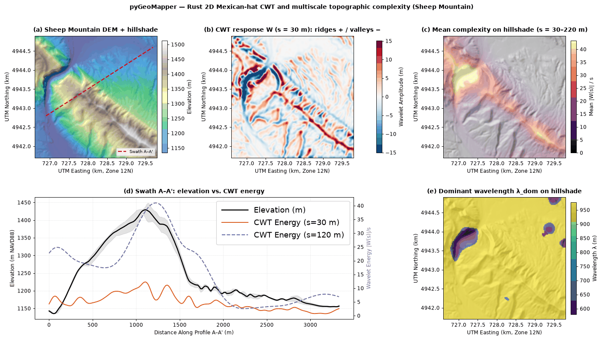
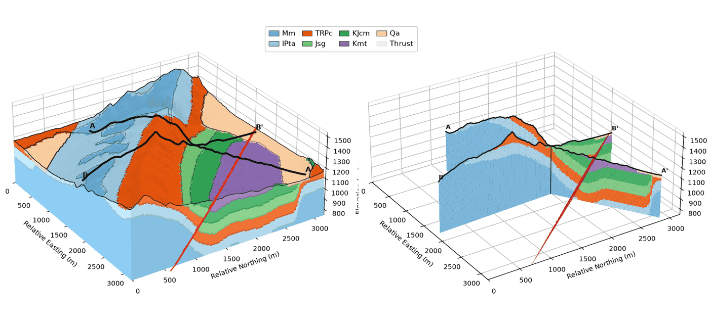
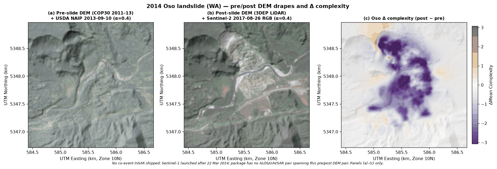
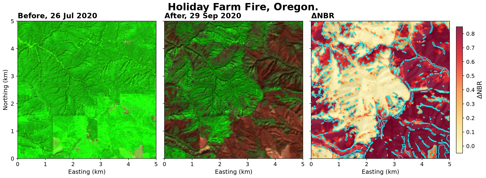
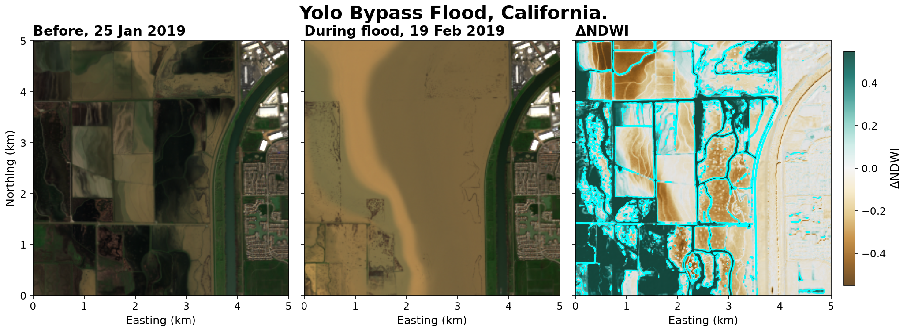
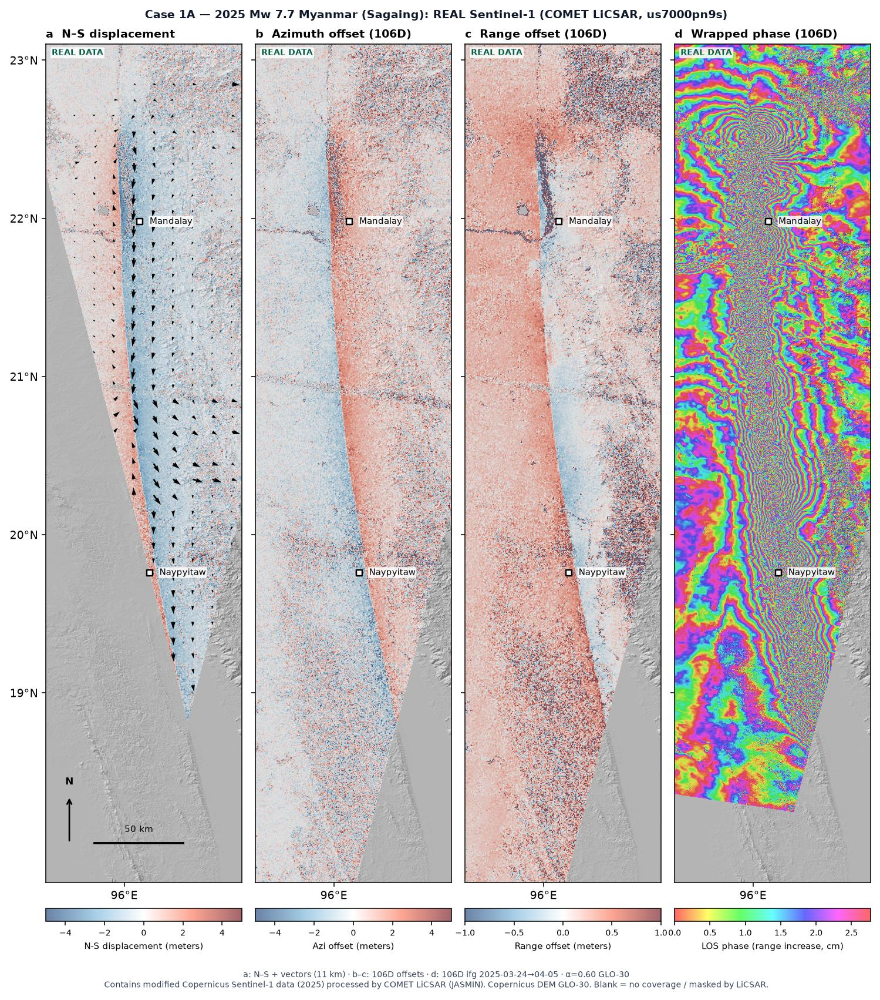
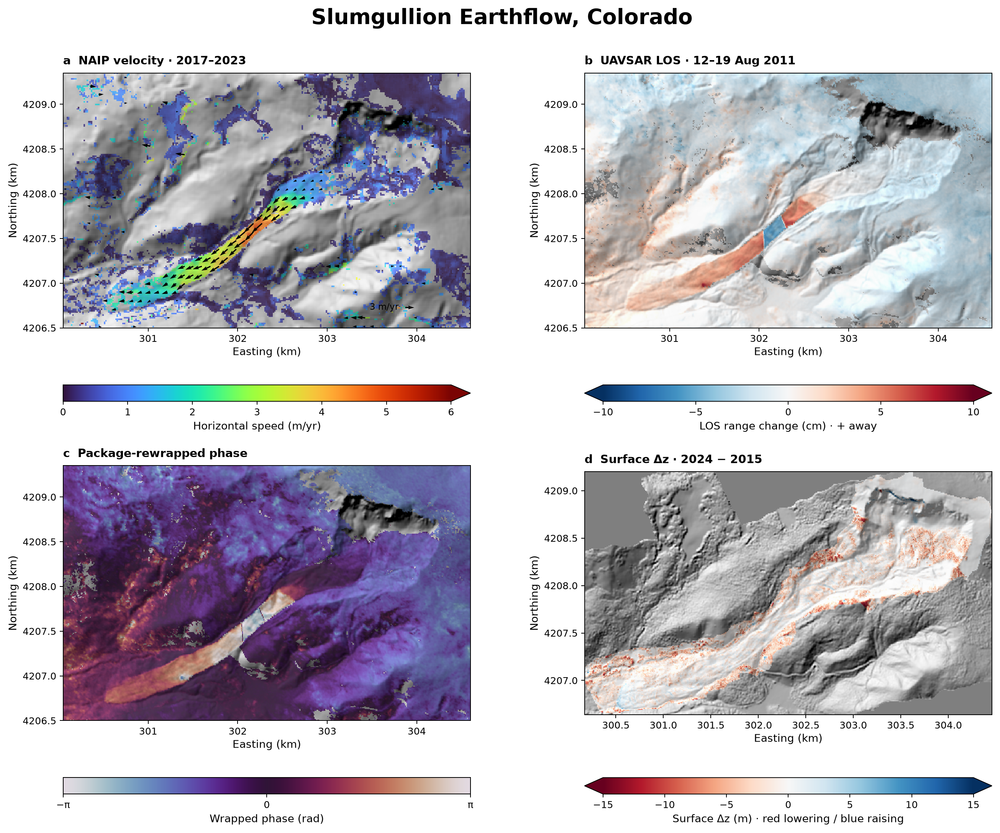
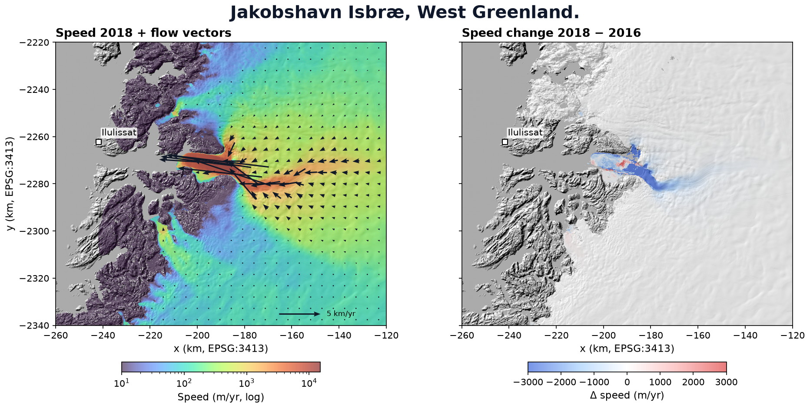

<p align="center"></p>
<p align="center">
<a href="https://doi.org/10.5281/zenodo.23832020"></a> <a href="https://github.com/GeoLarryLai/pyGeoMapper/blob/main/LICENSE"></a>
<br>
<a href="https://pypi.org/project/pygeomapper/"></a> <a href="https://pypi.org/project/pygeomapper/"></a> <a href="https://pepy.tech/projects/pygeomapper"></a>
</p>

# pyGeoMapper

> [!WARNING]
> **pyGeoMapper** is under active development, and many functions are still experimental and not fully validated. Please use with caution.

**pyGeoMapper** maps what changed on the ground, and what it's made of, using satellite images and elevation models (DEMs). I wanted one place to go from raw rasters to something a geologist can actually read: change maps after a landslide, flood, wildfire, earthquake, volcano or glacier event, unit maps scored against a real geologic map, and cross-sections and 3D block diagrams you can open in a browser. It's Python with a Rust core. (Not related to `The-Magicians-Code/PyGeoMapper`.)

## Installation

```bash
pip install pygeomapper
# from source (Python 3.10+, Rust 1.75+):
git clone https://github.com/GeoLarryLai/pyGeoMapper.git && cd pyGeoMapper
pip install maturin && maturin develop --release
```

`pip install pygeomapper` includes the `forge3d` 3D terrain renderer. If the renderer is missing, run `pip install forge3d`; otherwise `viewer_3d` falls back to its built-in renderer automatically.

## Citation

Lai, L.S.-H. (2026) pyGeoMapper. *Zenodo*, [https://doi.org/10.5281/zenodo.23832020](https://doi.org/10.5281/zenodo.23832020)

Methods: [Horn (1981)](https://doi.org/10.1109/PROC.1981.11918),
[Zevenbergen & Thorne (1987)](https://doi.org/10.1002/esp.3290120107),
[Nuth & Kääb (2011)](https://doi.org/10.5194/tc-5-271-2011),
[Montero et al. (2023)](https://doi.org/10.1038/s41597-023-02096-0),
[Lai et al. (2025)](https://doi.org/10.5194/esurf-13-417-2025),
[Brown et al. (2025)](https://arxiv.org/abs/2507.22291),
[Okada (1985)](https://doi.org/10.1785/BSSA0750041135),
[Staley et al. (2017)](https://doi.org/10.1016/j.geomorph.2016.10.019),
[Horton et al. (2017)](https://doi.org/10.3133/ds1052). Data sources: `example_data/SOURCES.txt`, `NOTICE`.

## What it can do

- Map terrain and surface features: spectral indices plus slope, curvature, roughness, and multiscale CWT complexity
- Make supervised geologic unit maps from AlphaEarth embeddings and other features, scored against a geologic map
- Reconstruct those maps as cross-sections and 3D geologic models you can open in a browser
- Detect surface change at different temporal and spatial scales: DEM of Difference, spectral change, and InSAR, including landslides, fires, floods, earthquakes, earthflows, and glaciers

## Landscape features and geologic mapping

This part covers automated geologic mapping with supervised machine learning. Models are trained from geomorphic surface features and surface-geology constraints, then the mapped units are reconstructed as cross-sections and a 3D structural model.


*Sheep Mountain, Wyoming: 2D Mexican-hat CWT — DEM, ridges and valleys, mean complexity, A–A′ energy profile, and dominant wavelength.*


*Automatic geologic mapping at Sheep Mountain, Wyoming, from 64-band AlphaEarth embeddings. USGS map units in the northwest half trained the model; the southeast half was held out (validation accuracy 91.0%, macro-F1 0.89).*

| Method | Bands | Validation accuracy | Macro-F1 |
| :--- | ---: | ---: | ---: |
| Engineered spectral and terrain | 29 | 69.1% | 0.64 |
| AlphaEarth embeddings | 64 | 91.0% | 0.89 |
| Combined | 93 | 89.5% | 0.87 |


*Sheep Mountain, Wyoming: A–A′ and B–B′ (~60° apart) from 3-point bed attitudes, with the published SW-dipping ~50° basement thrust.*


*Sheep Mountain, Wyoming: an opaque geologic block and the matching faulted A–A′ and B–B′ sections rotate together, 72 frames at 3 fps (about 24 seconds per turn).*

## Surface change

This part is a set of toolkits for detecting surface change at different temporal and spatial scales, using a range of remote-sensing data types and methods.


*2014 Oso landslide, Washington: DEM of Difference (red = erosion, blue = deposit) and spectral change, the two basic ways the package spots change on the ground.*


*2014 Oso landslide, Washington: pre DEM and 2013 NAIP, post DEM and 2017 Sentinel-2, and the change in terrain complexity.*


*2020 Holiday Farm Fire, Oregon: Sentinel-2 SWIR–NIR–red composites before and after the fire, and the burn-ratio change (ΔNBR). The cyan outline marks higher debris-flow hazard.*


*2019 Yolo Bypass flood, California: Sentinel-2 before and during the flood, and the water-index change (ΔNDWI). The cyan outline is the mapped shoreline.*


*2025 Mw 7.7 earthquake on the Sagaing Fault, Myanmar: Sentinel-1 LiCSAR north–south displacement, azimuth and range offsets, and wrapped phase.*


*Slumgullion Earthflow, Colorado: NAIP optical velocity (2017–2023), package-computed UAVSAR LOS and rewrapped phase (12–19 August 2011), and 2024−2015 elevation change (red = lowering, blue = raising). Arrows are optical motion only.*


*Jakobshavn Isbræ, West Greenland: NASA ITS_LIVE surface velocity in 2018 with flow directions, and the 2018−2016 change in speed.*

Five notebooks in `notebooks/` walk through every module with public data (spectral and surface change,
terrain complexity, auto-mapping and cross-sections, 3D, and a multi-hazard showcase).

## Quick start

```python
from pygeomapper import raster_io, surface_change, terrain_analysis

dem1 = raster_io.load_geotiff("example_data/oso_dem_pre_cop30.tif")
dem2 = raster_io.load_geotiff("example_data/oso_dem_post_3dep.tif")
dod = surface_change.compute_dod(dem1, dem2)                        # elevation change between the two DEMs
cwt = terrain_analysis.compute_multiscale_complexity(dem2)          # terrain roughness at several scales
```

Third-party notices and data credits: [`NOTICE`](NOTICE).
