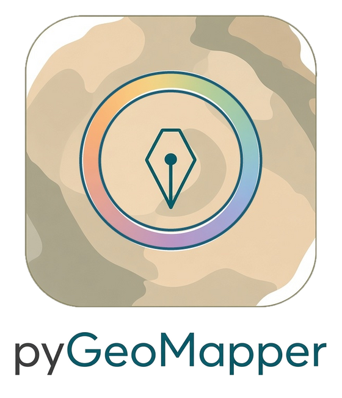
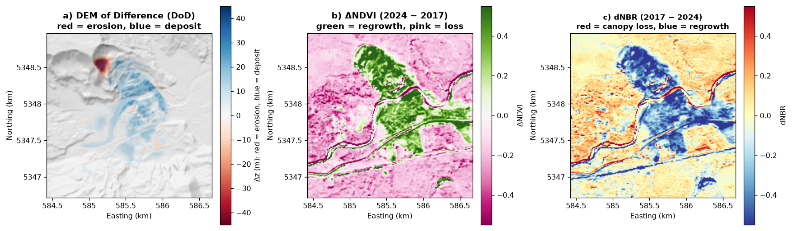
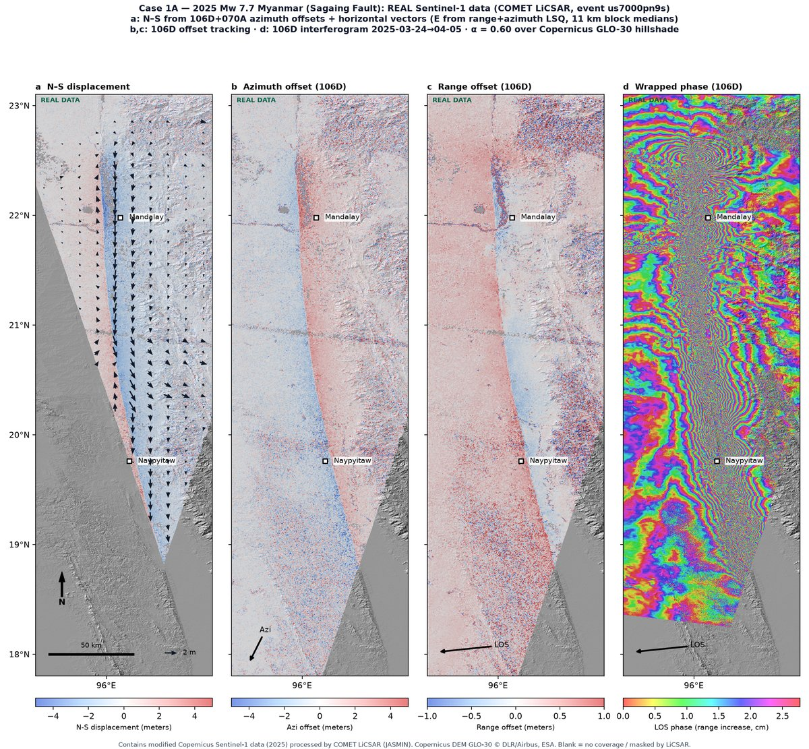
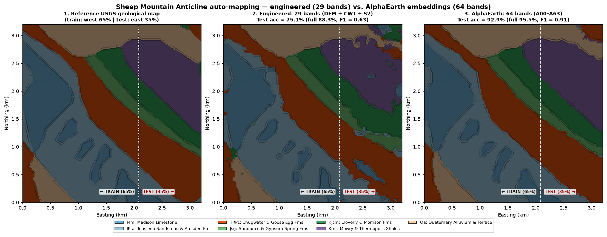
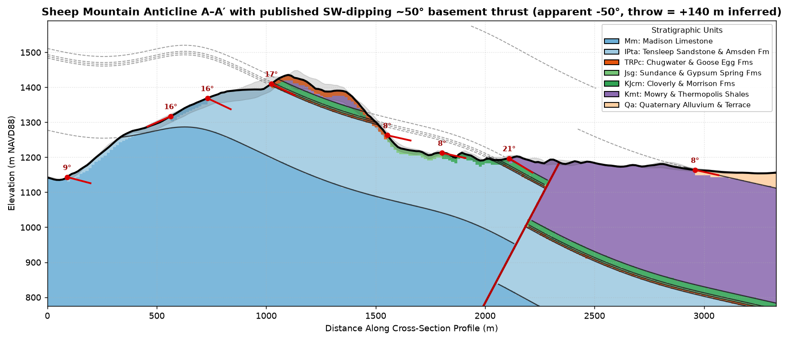
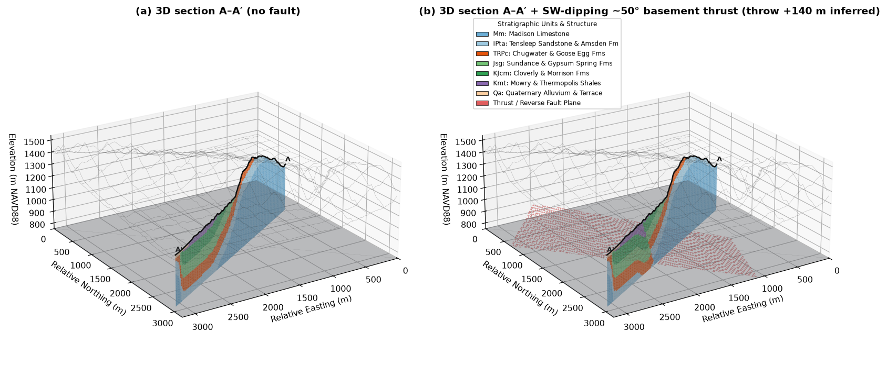

<p align="center"></p>

# pyGeoMapper

[](https://pypi.org/project/pygeomapper/) [](https://pepy.tech/project/pygeomapper) [](https://doi.org/10.5281/zenodo.ZENODO_CONCEPT_DOI)

v0.1.0



Maps what changed on the ground, and what it is made of, from satellite images and elevation models (DEMs).
Python with a Rust core, ending in 3D block diagrams you can open in a browser.

Status: early-stage research software. APIs may change; check results before use.
Not related to `The-Magicians-Code/PyGeoMapper`.

## Installation

```bash
pip install pygeomapper
# from source (Python 3.10+, Rust 1.75+):
git clone https://github.com/GeoLarryLai/pyGeoMapper.git && cd pyGeoMapper
pip install maturin && maturin develop --release
```

Optional extras: `stac`, `ml`, `viz3d`, `spectral`, `dem`, `test`.

## Citation

Lai, L.S.-H. (2026) pyGeoMapper. *Zenodo*, [https://doi.org/10.5281/zenodo.ZENODO_CONCEPT_DOI](https://doi.org/10.5281/zenodo.ZENODO_CONCEPT_DOI)

Methods: [Horn (1981)](https://doi.org/10.1109/PROC.1981.11918),
[Zevenbergen & Thorne (1987)](https://doi.org/10.1002/esp.3290120107),
[Nuth & Kääb (2011)](https://doi.org/10.5194/tc-5-271-2011),
[Montero et al. (2023)](https://doi.org/10.1038/s41597-023-02096-0),
[Lai et al. (2025)](https://doi.org/10.5194/esurf-13-417-2025),
[Brown et al. (2025)](https://arxiv.org/abs/2507.22291),
[Okada (1985)](https://doi.org/10.1785/BSSA0750041135),
[Staley et al. (2017)](https://doi.org/10.1016/j.geomorph.2016.10.019),
[Horton et al. (2017)](https://doi.org/10.3133/ds1052). Data sources: `example_data/SOURCES.txt`, `NOTICE`.

## Key Features

- **Surface change:** DEM of Difference with co-registration, spectral change and InSAR/GNSS 3D displacement
  for landslides, floods, wildfires, earthquakes, volcanoes and glaciers.
- **Spectral and terrain:** NDVI, NBR, NDWI and mineral ratios; slope, curvature, roughness and multiscale CWT complexity.
- **Geological mapping:** unsupervised and supervised unit maps with spatial-block holdout accuracy.
- **Sections and 3D:** cross-sections, 3D block, cutaway and fence diagrams, and an offline WebGL viewer.

## Results


*2025 Mw 7.7 Myanmar earthquake: ground displacement and offsets from Sentinel-1 (COMET LiCSAR).*


*Sheep Mountain Anticline: auto-mapped units vs the USGS map, scored on a held-out block.*


*Sheep Mountain Anticline cross-section with 3-point bed attitudes.*


*3D block diagram of the same area.*

Five executed notebooks in `notebooks/` walk through every module with public data (spectral and surface change,
terrain complexity, auto-mapping and cross-sections, 3D, and a multi-hazard showcase).

## Quick start

```python
from pygeomapper import raster_io, surface_change, terrain_analysis

dem1 = raster_io.load_geotiff("example_data/oso_dem_pre_cop30.tif")
dem2 = raster_io.load_geotiff("example_data/oso_dem_post_3dep.tif")
dod = surface_change.compute_dod(dem1, dem2)                        # elevation change between the two DEMs
cwt = terrain_analysis.compute_multiscale_complexity(dem2)          # terrain roughness at several scales
```

## License

Copyright (C) 2026 Larry Syu-Heng Lai. AGPL-3.0-or-later (`LICENSE`, `NOTICE`).
